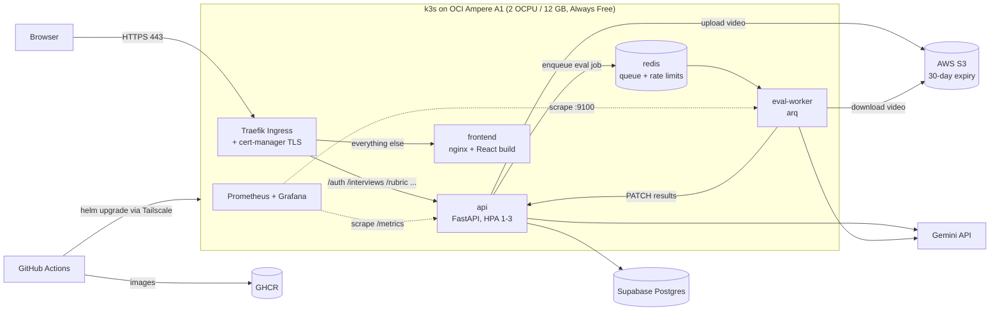

<div align="center">

#  MockMate

### AI-Powered Technical Interview Coach

**Practice. Get evaluated. Ace your next interview.**

[](https://fastapi.tiangolo.com)
[](https://react.dev)
[](https://www.typescriptlang.org)
[](https://postgresql.org)
[](https://docker.com)
[](https://deepmind.google/technologies/gemini)

[](https://github.com/pramodlv007/MockMate/actions/workflows/deploy.yml)
[](https://aws.amazon.com/ec2)
[](https://aws.amazon.com/s3)
[](https://supabase.com)

**Live:** http://3.19.239.13

</div>

---

## The Problem

Most engineers fail technical interviews — not because they lack the skills, but because they've never practiced in a realistic setting. Mock interviews with peers are hard to schedule. Platforms like LeetCode train you to solve problems but not to communicate your thinking. You finish a practice session with no idea whether your answers, delivery, or body language were good enough.

**MockMate was built to fix that.**

The idea started from a simple question: *what if you could have an AI sit across from you, ask exactly the questions a real Google or Amazon interviewer would ask based on your resume and the job description, record your response, and then give you brutally honest feedback on everything — content, communication, confidence, pace, and eye contact?*

That's MockMate.

---

## What MockMate Does

MockMate is a full end-to-end interview simulation platform. You pick a company, paste a job description, and MockMate generates a tailored set of questions from your actual resume. You answer on camera in the browser. When you're done, a multi-agent AI pipeline evaluates the recording and returns a detailed scorecard within minutes.

**For the candidate:**
- Realistic interview experience — same pressure, same format, zero scheduling overhead
- Questions that reflect your actual experience, not generic bank questions
- Feedback that tells you *exactly* what you said wrong, with direct quotes and suggested rewrites
- A 7-day personalized study plan based on where you struggled

**For engineers studying AI/ML roles:**
- Resume-aware questions that probe your specific projects and tech stack
- Company-specific question styles (Google system design, Amazon leadership principles, Meta product sense, etc.)
- Strictness levels from beginner-friendly to FAANG bar

---

## How MockMate Helps You

| Pain Point | MockMate Solution |
|---|---|
| No realistic practice environment | Full video interview simulation in the browser |
| Generic prep that ignores your background | Questions generated from your resume + job description |
| Zero feedback after practice sessions | AI scorecard: content, communication, delivery, body language |
| Can't identify your own weak spots | Top-10 mistakes with direct quotes and specific fixes |
| No structure to your preparation | Personalized 7-day training plan based on your gaps |
| Unaware of filler words and pace issues | Speech metrics: WPM, filler count, pacing assessment |
| Body language blind spots | Vision AI scores eye contact, posture, and engagement |
| Questions repeat across sessions | Cross-session deduplication of previously asked questions |

---

## Architecture

MockMate runs on a single-node **k3s** Kubernetes cluster on Oracle Cloud's Always Free Arm VM. The backend is
one FastAPI image used two ways: the **api** Deployment (all services mounted in one process) and the
**eval-worker** Deployment, which runs evaluations from a Redis queue so a slow Gemini call never blocks requests.



### Service Breakdown

| Mount Path | Responsibility |
|---|---|
| `/auth/*` `/users/*` | Signup, login, JWT tokens, user profile |
| `/profile/*` | Resume upload & text extraction, GitHub analysis |
| `/questions/*` | AI question generation (Gemini 2.5 Flash + DeepSeek fallback). Internal only |
| `/interviews/*` | Session lifecycle, video upload to S3, transcripts, deletion. Owner-only access |
| `/evaluation/*` | AI evaluation pipeline. Internal only |
| `/rubric/*` | Practice mode: one question, graded against a fixed rubric (`services/rubric/bank.json`) |

"Internal only" endpoints require the `X-Internal-Token` header (`INTERNAL_API_TOKEN`); inside the api pod
the services call each other over `localhost`, and the worker calls the api Service.

---

## GenAI Pipeline

MockMate's evaluation runs as a queued job after the video upload (Redis + arq, retried 3x with backoff), powered by Gemini 2.5 Flash.

```
Video upload (S3, or local disk in dev)
     │
     ├─ Transcription ── Gemini: full transcript of the recording
     ├─ Body language ── Gemini video analysis (3-frame fallback): eye contact, posture, engagement
     └─ Speech metrics ─ no AI: real duration (ffmpeg), WPM, filler words
     │
     ▼
Per-question answers ── browser-captured transcripts if present, else LLM segmentation
     │
     ▼
Per-question evaluation ── LLM, with resume + JD context: 5 sub-scores + feedback
     │
     ▼
Composite score ── deterministic Python: content 60% · communication 25% · presence 15%
     │
     ▼
Synthesis ── LLM writes the summary only (scores are inputs, not outputs):
             hire recommendation, strengths, top mistakes, resume/JD alignment, 7-day training plan
```

Any failure marks the session `error`, which the Results page shows instead of a spinner.

### Question Generation Intelligence

- **Resume parsing** — extracts tech stack, projects, experience level
- **Company patterns** — tailored question styles for Google, Amazon, Meta, Apple, Microsoft, Netflix, Stripe, OpenAI, Uber, Airbnb
- **Cross-session deduplication** — never repeats questions for the same user
- **JD alignment** — maps job description keywords to question themes

### Interviewer Personas & Strictness

| Persona | Style |
|---|---|
| Friendly | Warm, supportive, encouraging |
| Neutral | Balanced, professional, objective |
| Tough | FAANG-level critical, rigorous |

| Strictness | Benchmark |
|---|---|
| Easy | Fundamentals focus |
| Standard | Real-world industry bar |
| Strict | Top-1% — penalizes every vague answer |

---

## Infrastructure & Deployment

| Piece | Where | Notes |
|---|---|---|
| Cluster | k3s v1.31.4 on one OCI `VM.Standard.A1.Flex` | Terraform: `infra/terraform/oci/` |
| App | Helm chart `deploy/helm/mockmate/` | api (HPA 1-3), eval-worker, frontend, redis (PVC) |
| TLS | cert-manager + Let's Encrypt HTTP-01 | HTTP redirects to HTTPS (`deploy/k3s/traefik-config.yaml`) |
| Monitoring | kube-prometheus-stack, 7-day retention | Dashboard: `deploy/helm/mockmate/dashboards/mockmate.json` |
| Cluster access | Tailscale | The k3s API (6443) is never opened to the internet |
| AWS | S3 videos, least-privilege IAM user, $20 budget alert | Terraform: `infra/terraform/aws/` |

### CI/CD (`.github/workflows/deploy.yml`)

```
every push / PR
  ├── test    — backend pytest + frontend build + helm lint
  └── images  — backend image smoke-tested against Postgres (health, /metrics, signup, worker import),
                then backend + frontend built for linux/amd64 + linux/arm64, pushed to GHCR tagged with the SHA
push to main, once repo variable DOMAIN is set
  └── deploy  — runner joins the tailnet, helm upgrade --atomic to that SHA (auto-rollback), HTTPS smoke test
```

### Metrics

`GET /metrics/` on the api (not routed by the Ingress, so not public) and `:9100/metrics` on the worker:
per-route latency histogram, interviews created, eval job duration and outcomes (success / retry / failure),
LLM latency and errors by provider and operation, eval queue depth. `make grafana` opens the dashboard.

### Deploy from scratch

Prerequisites: an OCI account (Always Free), the OCI CLI config (`~/.oci/config`), a Tailscale account,
terraform, helm, kubectl, a domain you can point at an IP.

```bash
# 1. VM + k3s. Tailscale: create a one-off auth key, and add tags tag:k3s / tag:ci to your ACL.
cp infra/terraform/oci/terraform.tfvars.example infra/terraform/oci/terraform.tfvars   # fill it in
export TF_VAR_tailscale_auth_key=tskey-auth-...
make infra-up                      # prints the public IP and the kubeconfig command

# 2. DNS: A record for your domain -> that IP. Kubeconfig as printed by step 1.

# 3. AWS: IAM user + 30-day expiry + budget alert, then a key for the user straight into the cluster
terraform -chdir=infra/terraform/aws apply -var bucket_name=mockmate-videos-pramod -var budget_email=you@example.com
kubectl create namespace mockmate
aws iam create-access-key --user-name mockmate-k8s   # copy the two values into the Secret below

# 4. App secrets (never in git)
kubectl -n mockmate create secret generic mockmate-secrets   --from-literal=SECRET_KEY=$(openssl rand -hex 32) --from-literal=REFRESH_SECRET_KEY=$(openssl rand -hex 32)   --from-literal=INTERNAL_API_TOKEN=$(openssl rand -hex 32)   --from-literal=POSTGRES_USER=... --from-literal=POSTGRES_PASSWORD=... --from-literal=POSTGRES_SERVER=...   --from-literal=POSTGRES_PORT=6543 --from-literal=POSTGRES_DB=postgres   --from-literal=GOOGLE_API_KEY=... --from-literal=GOOGLE_CLIENT_ID=...   --from-literal=AWS_ACCESS_KEY_ID=... --from-literal=AWS_SECRET_ACCESS_KEY=...
kubectl create namespace monitoring
kubectl -n monitoring create secret generic grafana-admin   --from-literal=admin-user=admin --from-literal=admin-password=$(openssl rand -hex 12)

# 5. cert-manager, monitoring, app
make deploy DOMAIN=mockmate.example.com EMAIL=you@example.com

# 6. CI: secrets KUBECONFIG_B64, TS_OAUTH_CLIENT_ID, TS_OAUTH_SECRET; variables DOMAIN, LETSENCRYPT_EMAIL
make status
```

If the node can't pull `ghcr.io/pramodlv007/mockmate-frontend`, set that package's visibility to public in
GitHub (Packages → package settings). The backend package already pulls anonymously.

Teardown: `make infra-down` (VM, network, reserved IP; prints the remaining Terraform state, which should be empty).

### Cost

Expected monthly cost from the providers' published free allowances, **not yet from a real bill**.
Replace with actual billing figures after the first full month.

| Service | What we use | Expected cost |
|---|---|---|
| OCI Compute | 1x A1.Flex, 2 OCPU / 12 GB (= the whole Always Free A1 allowance) | $0 |
| OCI Block storage | 100 GB boot volume (Always Free: 200 GB total) | $0 |
| OCI Networking | 1 reserved public IP (check *Limits, Quotas and Usage* in your tenancy) | $0 |
| AWS S3 | Interview videos, deleted after 30 days | Free tier first 12 months, then per-GB storage + requests |
| Supabase | Postgres | Free plan |
| GHCR / GitHub Actions | Public repo | $0 |
| Tailscale | Personal plan | $0 |
| Gemini API | Questions, transcription, evaluation | Depends on your Gemini plan and usage; not measured yet |

---

## Privacy & Data Retention

- **Consent:** users must tick a consent box on the interview setup page before anything is recorded.
- **Deletion:** `DELETE /interviews/{id}` (the **Delete** button in History) removes the S3 recording, then the
  session and its questions from the database. Only the owner can delete.
- **Retention:** recordings in S3 expire after 30 days, via the lifecycle rule in `infra/terraform/aws/`
  (`terraform -chdir=infra/terraform/aws apply`). It is not set by the app or CI, so the consent text is only
  true once that has been applied. Verify with
  `aws s3api get-bucket-lifecycle-configuration --bucket mockmate-videos-pramod`.

  Expiry removes the video only; the session's transcript and scores stay until the user deletes the interview.
- **Third parties:** recordings are uploaded to Google Gemini for transcription and body-language analysis;
  transcripts (text only) may go to DeepSeek as a fallback.

## Tech Stack

### Backend
| Layer | Technology |
|---|---|
| Framework | FastAPI (async Python 3.11) |
| Auth | `python-jose` (JWT), `passlib[bcrypt]` |
| ORM | SQLAlchemy + psycopg2 |
| HTTP Client | httpx (async) |
| Video Storage | boto3 → AWS S3 |
| Resume Parsing | pdfplumber, python-docx |
| Rate Limiting | slowapi |

### AI / GenAI
| Purpose | Model |
|---|---|
| Question Generation | Gemini 2.5 Flash (primary) · DeepSeek (fallback) |
| Video Transcription | Gemini 2.5 Flash native video |
| Content Evaluation | Gemini 2.5 Flash |
| Vision Analysis | Gemini 2.5 Flash (frame sampling) |

### Frontend
| Layer | Technology |
|---|---|
| Framework | React 18 + TypeScript |
| Build Tool | Vite |
| Styling | Tailwind CSS |
| Video Recording | MediaRecorder API (native browser) |
| Speech-to-Text | Web Speech API (per-question transcripts) |
| State & Auth | React Context + JWT |

---

## Getting Started (Local)

### Prerequisites
- Python 3.11+
- Node.js 20+
- PostgreSQL (or a Supabase project)
- Gemini API key (free at [aistudio.google.com](https://aistudio.google.com))

### 1. Clone & Configure

```bash
git clone https://github.com/pramodlv007/MockMate.git
cd MockMate
cp backend/.env.example backend/.env   # then fill in GOOGLE_API_KEY, SECRET_KEY, REFRESH_SECRET_KEY
```

`backend/.env.example` documents every variable the backend reads. Leave the `*_SERVICE_URL` variables unset.

### 2. Start Backend

```bash
cd backend
pip install -r requirements.txt
uvicorn app_consolidated:app --reload --port 8000
```

### 3. Start Frontend

```bash
cd frontend
npm install
npm run dev
```

Optional `frontend/.env`: `VITE_API_URL` (default `http://localhost:8000`) and `VITE_GOOGLE_CLIENT_ID`.

### Tests

```bash
cd backend
python -m pytest tests rubric_eval
```

The tests use in-memory SQLite and mock S3/LLM calls; no services or keys needed.

### 4. Open the App

| Service | URL |
|---|---|
| Frontend | http://localhost:5173 |
| API Docs | http://localhost:8000/docs |

---

## Project Structure

```
MockMate/
├── .github/workflows/
│   ├── deploy.yml                 # CI/CD: test → image → EC2 deploy
│   └── diagnose.yml               # manual read-only EC2 diagnostics
├── aws/setup-https.sh             # Let's Encrypt setup on EC2
├── nginx/mockmate.conf            # static frontend + API reverse proxy
├── backend/
│   ├── app_consolidated.py        # Single FastAPI app — all services mounted
│   ├── common/
│   │   ├── auth.py                # JWT validation, internal-token check, rate-limit key
│   │   └── database.py            # SQLAlchemy engine + session
│   ├── services/
│   │   ├── auth/                  # Signup, login, Google sign-in, token refresh, user profile
│   │   ├── profile/               # Resume upload, GitHub analysis
│   │   ├── question/              # AI question generation engine
│   │   │   ├── engine.py          # Gemini + DeepSeek, resume intelligence
│   │   │   └── company_patterns.py # Per-company question styles
│   │   ├── interview/             # Sessions, video upload, transcripts, deletion
│   │   ├── evaluation/            # AI evaluation pipeline
│   │   └── rubric/                # Rubric-graded practice questions
│   ├── rubric_eval/               # Grader metrics + tests
│   ├── tests/                     # API tests (auth, ownership, limits, speech metrics)
│   ├── Dockerfile.consolidated    # The image CI builds and EC2 runs
│   └── requirements.txt
└── frontend/
    ├── src/
    │   ├── pages/                 # Home, Login, Signup, InterviewSetup, InterviewRoom, Results, History, Practice, Profile
    │   ├── components/            # Header, GoogleButton
    │   └── context/               # Auth context
    └── package.json
```

---

## Authentication Flow

```
Signup / Login / Google → Access token (30 min, kept in memory, sent as Bearer)
                        + Refresh token (7 days, HttpOnly cookie, rotated on every refresh)
                                │
        On page load or any 401 → silent POST /auth/refresh, then retry the request
                                │
                     Logout → cookie cleared, in-memory token dropped
```

---

## License

MIT License. No LICENSE file has been added to the repository yet.

---

<div align="center">

Built by [Pramod](https://github.com/pramodlv007)

**MockMate — Because every interview deserves a rehearsal.**

</div>
