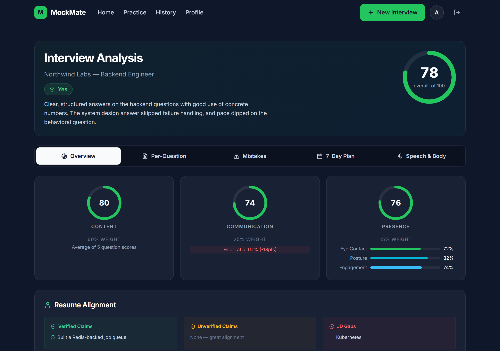
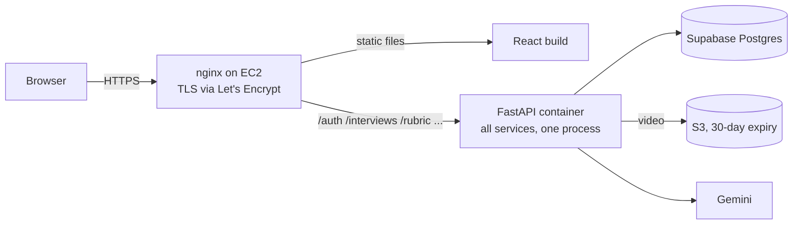

<div align="center">

# MockMate

**An AI interviewer that reads your resume, asks you questions on camera, and tells you exactly what to fix.**

[**Live: mockmate.site**](https://mockmate.site)

[](https://github.com/pramodlv007/MockMate/actions/workflows/deploy.yml)
[](https://fastapi.tiangolo.com)
[](https://react.dev)
[](https://aws.amazon.com/ec2)
[](https://ai.google.dev)

</div>

MockMate is a full interview simulation. You paste a job description, it writes questions from the job and from your
resume, you answer on camera in the browser, and a few minutes later you get a scorecard: what you said wrong
(quoted back to you), how you sounded, how you looked, and a 7-day plan to improve.

<p align="center">
  
  <br><sub>The results page, shown with sample data.</sub>
</p>

## Features

- **Questions built from you.** Generated from your resume, GitHub profile and the job description, in the style of
  the target company, and told not to repeat what you were asked in earlier sessions.
- **Full mock interview.** Camera and microphone in the browser. Pick the interviewer persona (friendly, neutral,
  tough) and how strict the scoring is (learning, realistic, elite).
- **Scorecard.** Content 60%, communication 25%, presence 15%. Per-question feedback with an ideal-answer outline,
  top mistakes with direct quotes, resume-vs-claims gaps, and a 7-day training plan.
- **Real speech metrics.** Words per minute from the actual recording length, and filler-word counts, calculated
  by code rather than guessed by a model.
- **Practice mode.** One question at a time, answered by text, or by voice where the server has the optional speech-to-text install, graded against a fixed rubric. Every
  point the grader marks as covered must quote your own words as evidence, and invented quotes are rejected.
- **Accounts.** Email and password, or Google sign-in. Interviews can be deleted at any time from History.

## Quick start

You need Python 3.11, Node 20, Docker (for Postgres) and a free [Gemini API key](https://aistudio.google.com/app/apikey).

```bash
git clone https://github.com/pramodlv007/MockMate.git && cd MockMate

# 1. Database
docker compose -f docker-compose.dev.yml up -d postgres
# (if it says the name mockmate_postgres is already in use: docker start mockmate_postgres)

# 2. Backend  (http://localhost:8000/docs)
cd backend
cp .env.example .env          # set GOOGLE_API_KEY, SECRET_KEY, REFRESH_SECRET_KEY
pip install -r requirements.txt
uvicorn app_consolidated:app --reload --port 8000

# 3. Frontend  (http://localhost:5173), in a second terminal
cd frontend && npm install && npm run dev
```

`backend/.env.example` lists every variable the backend reads. Without `REDIS_URL` and `S3_BUCKET_NAME`, evaluations
run inside the API process and videos are saved to `backend/uploads/`, so nothing else needs to run locally.
Optional: `VITE_GOOGLE_CLIENT_ID` in `frontend/.env` and `GOOGLE_CLIENT_ID` in `backend/.env` turn on Google sign-in.

### Tests

```bash
cd backend && python -m pytest tests rubric_eval
```

They use in-memory SQLite and mock S3 and the LLMs, so they need no services or keys.

## How it works



The backend is one FastAPI app that mounts every service in a single process, run as one Docker container behind
nginx. Evaluations run as a background task inside that process. If `REDIS_URL` is set, they go to a Redis queue and
a separate `eval-worker` (arq) instead, so a slow Gemini call never blocks requests; that is how the Kubernetes setup
in `deploy/` runs it.

| Mount | Does | Access |
|---|---|---|
| `/auth` `/users` | Signup, login, Google sign-in, refresh tokens, profile | public / signed in |
| `/profile` | Resume upload and parsing, GitHub analysis | signed in |
| `/interviews` | Sessions, video upload, transcripts, deletion | owner only |
| `/rubric` | Practice mode questions and grading | signed in |
| `/questions` `/evaluation` | Question generation, scoring pipeline | internal only (`X-Internal-Token`) |

**An interview, end to end.** The interview service asks the question service for questions, using your resume,
the job description and, if a Tavily key is set, a web search for the company. The browser records video and per-question transcripts and
uploads them. The upload starts an evaluation, which then:

1. transcribes the video with Gemini and analyses body language (eye contact, posture, engagement);
2. computes duration, words per minute and filler words in plain code;
3. scores each answer with an LLM that sees your resume and the job description;
4. combines the scores with fixed weights in Python, then asks the LLM only to write the summary and plan.

If an evaluation fails, the session is marked `error` and the Results page says so. With the Redis worker it is
retried three times first.

**Auth.** A 30-minute access token is held in memory and sent as a Bearer token. A 7-day refresh token lives in an
HttpOnly cookie and rotates on every refresh. Interview endpoints return 404 for someone else's interview.

## Tech stack

| | |
|---|---|
| Frontend | React 19, TypeScript, Vite, Tailwind, Framer Motion. Browser MediaRecorder and Web Speech API |
| Backend | FastAPI, SQLAlchemy, Postgres, slowapi, Prometheus client; optional arq + Redis worker |
| AI | Gemini 2.5 Flash for questions, transcription, vision and scoring; DeepSeek as a text fallback |
| Infra | AWS EC2, Docker, nginx, Let's Encrypt. Optional k3s, Helm and Terraform setup, not in use (see Deployment) |
| Storage | Supabase Postgres, AWS S3 for videos |
| CI/CD | GitHub Actions: tests, Docker image to GHCR, deploy to EC2 over SSH with automatic rollback |
| Monitoring | Prometheus metrics at `/metrics` (not exposed by nginx); Grafana dashboard in `deploy/helm/mockmate/dashboards/` |

## Deployment

**Production runs on AWS EC2.** A push to `main` runs the tests, builds the backend image, pushes it to GHCR, syncs
the frontend build and nginx config to the server, swaps the container, and rolls back to the previous image if the
health check fails (`.github/workflows/deploy.yml`). `aws/setup-https.sh` sets up Let's Encrypt on the server.

The repo also contains a Kubernetes setup (k3s on an Oracle Cloud Always Free VM, Helm chart, Terraform, monitoring).
It is **not what production runs today**. It is documented in [docs/deployment.md](docs/deployment.md).
`inference/` is a standalone Modal app serving Qwen3-8B and faster-whisper; the backend does not call it yet.

## Privacy

- Recording starts only after the user ticks a consent box on the setup page.
- Recordings go to Google Gemini for transcription and body-language analysis. Transcripts (text only) may go to
  DeepSeek if Gemini fails.
- `DELETE /interviews/{id}` removes the S3 video, then the session and its questions. Only the owner can call it.
- Videos should expire from S3 after 30 days. The lifecycle rule is defined in `infra/terraform/aws/`, but the app and
  CI do not apply it, so apply it with Terraform (or set it in the S3 console) and check it with
  `aws s3api get-bucket-lifecycle-configuration --bucket <bucket>`. Expiry removes the video only. Transcripts and
  scores stay until the user deletes the interview.
- There is no "delete my account" feature yet.

## Project layout

```
backend/
  app_consolidated.py   the API: mounts every service
  common/               JWT and internal-token auth, database, metrics
  services/             auth, profile, question, interview, evaluation (incl. queue.py worker), rubric
  tests/  rubric_eval/  pytest suites
frontend/src/           pages, components, auth context, api client
nginx/  aws/            nginx config, HTTPS setup script (production, EC2)
deploy/  infra/         Helm chart, k3s and monitoring config, Terraform (not in production)
inference/              Modal app for self-hosted models (not wired in)
docs/deployment.md      runbook for the k3s setup
```

## License

[MIT](LICENSE)
